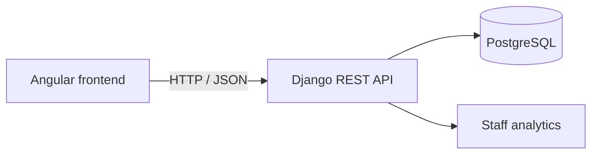
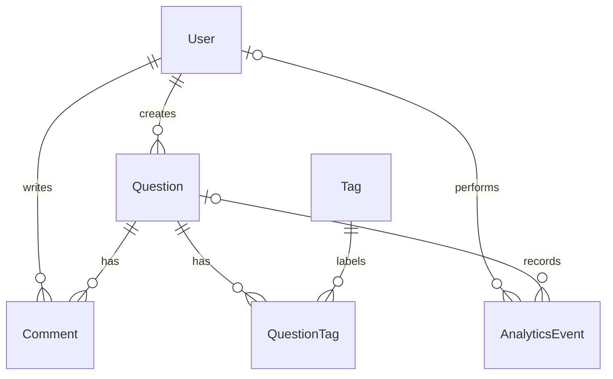

# Stack Underflow — Developer Q&A Platform

> An open-source educational Q&A platform where students can ask programming questions, share knowledge and learn from each other.

    

**Project status:** Student MVP. Local setup is documented; public deployment has not been re-verified.

## Contents

- [Problem & Solution](#problem--solution)
- [SDG Alignment](#sdg-alignment)
- [DPG Justification](#dpg-justification)
- [Target Users](#target-users)
- [Features and Pages](#features-and-pages)
- [Tech Stack](#tech-stack)
- [Semester Scope](#semester-scope)
- [Structure and Database](#structure-and-database)
- [Local Setup](#local-setup-with-postgresql)
- [Verify the MVP](#verify-the-mvp)
- [How to Use](#how-to-use)
- [Documentation](#documentation)
- [How to Contribute](#how-to-contribute)
- [Privacy and Community Safety](#privacy-and-community-safety)
- [License and Team](#license-and-team)
- [AI Usage Disclosure](#ai-usage-disclosure)
- [Market & Competitor Analysis](#market--competitor-analysis)
- [Roadmap](#roadmap)

## Problem & Solution

**Problem:** Students often ask programming questions in private chats. Useful answers can be difficult to find later, and the same questions may be asked many times. Beginners may also need a smaller learning community where they feel comfortable asking basic questions.

**Solution:** Stack Underflow provides a searchable Q&A forum with tags, comments and user accounts. Students can share solutions, discover existing discussions and build a reusable knowledge base. Universities and student communities can host their own instance instead of depending on a commercial discussion service.

## SDG Alignment

Stack Underflow supports **UN Sustainable Development Goal 4 — Quality Education**.

| Target | Project contribution |
|---|---|
| SDG 4.3 — Access to technical and higher education | A freely available software platform for peer learning and sharing educational resources. |
| SDG 4.4 — Relevant skills for employment | Programming discussions help learners develop technical and problem-solving skills. |

The project aims to support these targets; educational outcomes have not yet been measured. See the [UN SDG 4 description](https://sdgs.un.org/goals/goal4).

## DPG Justification

Stack Underflow is designed to follow Digital Public Good principles. This is a student self-assessment, not official DPG recognition.

| Criterion | How Stack Underflow addresses it | Evidence / remaining work |
|---|---|---|
| Relevant to SDGs | Supports peer learning and digital skills under SDG 4. | [SDG Alignment](#sdg-alignment) |
| Open Source License | MIT permits reuse, modification and distribution subject to its conditions. | [LICENSE](LICENSE); confirm rights to inherited code. |
| Clear Ownership | The license names the copyright holders and the contribution guide names maintainers. | [LICENSE](LICENSE), [CONTRIBUTING](CONTRIBUTING.md) |
| Platform Independence | Uses Angular, Django, PostgreSQL and configurable REST APIs; supports self-hosting. | [Local setup](#local-setup-with-postgresql), [deployment guide](docs/deployment.md); external font dependency remains. |
| Documentation | Installation, database design, API documentation, tests and contribution instructions are available. | [Documentation](#documentation) |
| Non-Discrimination & Do No Harm | Community rules prohibit harassment, discrimination and disclosure of private information. | [Code of Conduct](CODE_OF_CONDUCT.md); dedicated private reporting channel remains to be confirmed. |
| Privacy and Data Security | Password hashing, JWT authentication, private environment configuration and staff-only analytics are documented. | [Privacy policy](PRIVACY.md); account deletion, privacy notice and retention automation remain planned. |

## Target Users

- University students learning programming and software engineering.
- Junior developers looking for explanations and examples.
- Teachers and mentors supporting student communities.
- Universities interested in hosting their own educational forum.
- Open-source contributors improving educational software.

## Features and Pages

Visitors can browse and search questions without an account. Registration and login are required to create questions and write comments.

| Page | Route | Purpose |
|---|---|---|
| Home | `/home` | Introduction and navigation |
| Questions | `/questions` | Browse, keyword search and tag filtering |
| Question details | `/questions/:slug` | Read a question and its comments |
| Ask question | `/newquestion` | Create a question with optional tags |
| Edit question | `/questions/edit/:slug` | Edit an existing question |
| Tags | `/tags`, `/tags/:slug` | Browse topics and related questions |
| Authentication | `/signup`, `/login` | Register and sign in |
| Analytics | `/analytics` | Staff dashboard with event totals and most viewed questions |

### Search and analytics

Search uses keyword matching and PostgreSQL trigram indexes, not AI embeddings. Suggestions appear after 300 ms and show up to five results. Keyword and tag filters can be combined.

```http
GET /api/questions/list?search=django&tag=python
```

Analytics records searches, question views and question creation. The staff-only summary endpoint (`GET /api/analytics/summary/`) returns lifetime totals and up to five most viewed active questions. Counts represent requests/events, not unique people. See [analytics documentation](docs/analytics.md).

## Tech Stack

| Layer | Technology |
|---|---|
| Frontend | Angular, TypeScript |
| Backend | Python 3.12, Django REST Framework |
| Database | PostgreSQL; optional SQLite for local development |
| Authentication | JWT |
| API documentation | OpenAPI / Swagger |
| Containerization | Docker Compose |
| Testing | pytest, Angular browser tests |

### Platform independence

The project can run locally or on a compatible hosting provider. The frontend API URL is configurable, data is stored in PostgreSQL, and the API uses HTTP and JSON. Render is a documented deployment option, not a mandatory service. The current production frontend build fetches a Google Fonts stylesheet and therefore requires internet access; removing this dependency is a possible improvement.

## Semester scope

MVP features and documented status. Historical test results are retained from the existing project documentation; no new tests were run for this README update.

| Feature | Status | Where |
|---|---|---|
| Registration and JWT login | Done | `/signup`, `/login`; `apps/users` |
| Ask a question with tags; edit/delete your own | Done | `/newquestion`, `/questions/edit/:slug`; `apps/questions` |
| Browse questions and open question details | Done | `/questions`, `/questions/:slug` |
| Comment on questions | Done | Question detail page; `apps/comments` |
| Browse tags and the questions under each tag | Done | `/tags`, `/tags/:slug`; `apps/tags` |
| Keyword + tag search (US-03) | Done | Search box + tag filter on `/questions`; `?search=&tag=` API, documented in Swagger |
| Database indexes with measured impact (US-08) | Done | Migrations + [EXPLAIN ANALYZE results](docs/explain_analyze.md): search 12.8 ms → 0.5 ms |
| Usage analytics | Implemented; verification pending | Events, [SQL queries](docs/analytics_queries.sql), Django admin and a staff dashboard are present in the supplied archive; end-to-end verification is pending |
| Public deployment | Partial | [Render setup](docs/deployment.md); the production frontend points at the Render API, which was not re-verified for this release |
| Automated tests | Partial | Backend pytest suite passes except one flaky legacy chat test; Angular specs need Chrome to run |

**Outside the MVP:** `backend/apps/chat` (WebSocket chat via Channels + Redis) is
a prototype that predates the semester scope. It is not in `INSTALLED_APPS`,
it is not part of the demo flow, and it is not required to run the MVP. The same
applies to the Celery/Redis services behind the `legacy` Compose profile, and to
the profile and user-management pages.

## Structure and database



```text
backend/                  Django apps and stack_underflow settings
frontend/                 Existing Angular components and services
docs/                     TSIS 3, schema, analytics and deployment
docker-compose.yml        Backend + PostgreSQL; optional legacy services
```



[Real table names, keys and fields](docs/database_schema.md) ·
[PostgreSQL DDL](docs/database_schema.sql) · [TSIS 3 deliverables](docs/TSIS3_MVP.md)

## Local setup with PostgreSQL

Use Python 3.12, Node.js 18/npm and Docker Compose. Clone the repository first:

```bash
git clone https://github.com/Adul23/stack-underflow.git
cd stack-underflow
```

The commands below use a POSIX shell (macOS/Linux or a compatible shell on Windows). From the repository root:

```bash
cp backend/.env.example backend/.env
python3 -c 'import secrets; print(secrets.token_urlsafe(48))'
```

Put the generated value in STACK_UNDERFLOW_SECRET_KEY and choose a private
DB_PASSWORD in backend/.env. Existing private .env files should be preserved;
compare them with the example instead of copying over them.

Main variables: STACK_UNDERFLOW_ENV_ID=local, DB_NAME, DB_USER, DB_PASSWORD,
DB_HOST=127.0.0.1, DB_PORT=5432, DB_SSLMODE=disable, ALLOWED_HOSTS and
CORS_ALLOWED_ORIGINS. Keep the example's local host/origin values for development.
The .env file is ignored by Git.

Start PostgreSQL:

```bash
docker compose --env-file backend/.env up -d db
```

Start Django:

```bash
python3 -m venv .venv
source .venv/bin/activate
pip install -r backend/requirements/base.txt
cd backend
python manage.py check
python manage.py migrate
python manage.py createsuperuser
python manage.py runserver
```

In a second terminal, from the repository root:

```bash
cd frontend
npm ci
npm start
```

Open http://localhost:4200. API docs: http://127.0.0.1:8000/api/docs/.
Admin: http://127.0.0.1:8000/admin/. There is no email-confirmation or worker
requirement for registration. Leave DB_HOST empty only if choosing the optional
SQLite developer fallback; deployed environments always use PostgreSQL.

Alternatively, run the backend in Docker (do not run another server on port 8000):

```bash
docker compose --env-file backend/.env up --build -d
docker compose --env-file backend/.env exec backend python manage.py migrate
docker compose --env-file backend/.env exec backend python manage.py createsuperuser
```

Compose sets DB_HOST=db inside the backend container. Start Angular using the
same npm commands. Existing Redis and Celery services are behind the legacy profile.

The Docker backend runs `backend/start.py` on every start: migrations, demo data,
static files, then the API server. `backend/seed_demo.py` adds 12 example questions
and 8 tags without clearing the database; repeated runs skip existing examples.
Run `python seed_demo.py` manually from `backend/`, or set `SEED_DEMO_DATA=False`
to disable automatic inserts. For Render, use the Dockerfile's default command
or Python Start Command `python start.py` with Root Directory `backend`.
See [demo data and Render settings](docs/deployment.md#automatic-demo-data-on-docker-and-render).

## Verify the MVP

With the virtual environment activated, from backend/:

```bash
python manage.py makemigrations --check --dry-run
python -m pytest tests/MVPTests.py tests/QuestionsTests.py tests/SearchTests.py tests/SeedBulkTests.py tests/UsersTests.py tests/TagsTests.py tests/CommentsTests.py -q
```

The database user needs CREATEDB permission for Django's disposable test database
(the local Compose database user has it). These tests exclude the old Redis chat tests.

From frontend/:

```bash
npm run build
npm test -- --watch=false --browsers=ChromeHeadless --include=src/app/components/questions/questions.component.spec.ts --include=src/app/app.component.spec.ts
```

Chrome must be installed for browser tests. The production build fetches the
existing Google Font stylesheet and needs internet access.

## How to Use

### Demo script

About 5 minutes. Start PostgreSQL, Django and Angular as described above, then
open http://localhost:4200. Optionally run `python manage.py seed` first so the
lists are not empty.

1. **Register.** Click Sign up, create an account, then log in. The navbar
   switches to the logged-in state.
2. **Create a question with tags.** Click Ask Question and enter
   - title: *How do I paginate a DRF viewset?*
   - description: a sentence or two
   - tags: `python`, `django`

   Submit. The new question opens and shows its tags.
3. **Search.** Go to Questions.
   - Type `paginate`. Suggestions appear after 300 ms.
   - Press Search to see the full results.
   - Pick `#django` in the tag dropdown. The list narrows to keyword + tag matches.
   - Click a tag chip on any card to filter by that tag. Click Clear to reset.
   - Optional: show the same call in Swagger at http://127.0.0.1:8000/api/docs/
     (`GET /api/questions/list?search=paginate&tag=django`).
4. **Comment.** Open the question, add a comment, and reload the page. The
   comment is still there.
5. **View the analytics summary.** Run the SQL below. It shows searches per day,
   the most common search terms (including `paginate`), the most viewed
   questions, popular tags and active sessions. You can also open
   http://127.0.0.1:8000/admin/ → Questions → Analytics events to show the
   individual events the demo just created.
6. **Staff dashboard.** Sign in with a staff account and open `/analytics` to view totals and the top five questions. The API requires staff permissions.
7. *(Optional)* **Performance.** Show the before/after table in
   [docs/explain_analyze.md](docs/explain_analyze.md).

Run the analytics SQL from the repository root (needs the Docker PostgreSQL database):

```bash
docker compose --env-file backend/.env exec -T db sh -c 'psql -U "$POSTGRES_USER" -d "$POSTGRES_DB" -v ON_ERROR_STOP=1' < docs/analytics_queries.sql
```

[Analytics fields and counting rules](docs/analytics.md) ·
[SQL queries](docs/analytics_queries.sql)

## Deployment and API URL

All frontend API calls use environment.apiUrl, with an optional public runtime
value in assets/config.js. For a separate production API host, after building:

```bash
cd frontend
STACK_UNDERFLOW_API_URL=https://api.your-domain.example/api npm run configure:api
```

See [deployment.md](docs/deployment.md) for exact PostgreSQL, DEBUG=False,
allowed-host, CORS, HTTPS, static-site and backend settings. Public deployment has not been re-verified for this release; hosting credentials may be needed.


## Documentation

| Document | Description |
|---|---|
| [MVP scope](docs/TSIS3_MVP.md) | Features, user flow and historical verification |
| [Database schema](docs/database_schema.md) | Tables, fields and relationships |
| [Database DDL](docs/database_schema.sql) | PostgreSQL schema |
| [Analytics](docs/analytics.md) | Event definitions, staff dashboard and counting rules |
| [Analytics SQL](docs/analytics_queries.sql) | Example reporting queries |
| [Performance](docs/explain_analyze.md) | Indexes and recorded query performance |
| [Deployment](docs/deployment.md) | Hosting and production configuration |
| [Source reference](docs/source_reference.md) | Origin of reused code and rebranding |
| [Study report (Russian)](docs/study/REPORT_RU.md) | MVP, database diagrams, CRUD and search |
| [Contribution guide](CONTRIBUTING.md) | How to submit changes |
| [Code of Conduct](CODE_OF_CONDUCT.md) | Community rules |
| [Privacy](PRIVACY.md) | Data collection, protection and planned improvements |

## How to Contribute

Contributions to code, tests, documentation and reproducible bug reports are welcome.

1. Read the [Code of Conduct](CODE_OF_CONDUCT.md) and [contribution guide](CONTRIBUTING.md).
2. Check existing issues and discuss the change with maintainers.
3. Fork the repository and create a focused branch, for example `fix-search-tags`.
4. Make the change and run the relevant checks from [Verify the MVP](#verify-the-mvp).
5. Open a Pull Request into `main` and describe the change, motivation and test results.
6. Respond to maintainer feedback.

Never include passwords, tokens or private `.env` files in a contribution. Only submit code you have the right to contribute.

## Privacy and Community Safety

The forum stores account information, public questions and comments, and usage analytics. Analytics includes search text, timestamps, optional user IDs and a browser session UUID. Users should not enter confidential information in searches or public posts.

The documented protections include Django password hashing, JWT authentication, staff-only analytics and private environment variables. Production configuration requires HTTPS and restricted hosts and CORS origins. These requirements are not a completed security audit.

Discrimination, harassment and publication of private information are prohibited. Report sensitive security or community concerns privately to a maintainer, not in a public issue. See [PRIVACY.md](PRIVACY.md) and [CODE_OF_CONDUCT.md](CODE_OF_CONDUCT.md).

## License and Team

The repository includes the [MIT License](LICENSE), naming Boris Dubovoy and Adil Yergazy as copyright holders. MIT allows use, modification and redistribution, including commercial use, provided the required notices are retained.

The project reuses code from an earlier MVP, as documented in [source_reference.md](docs/source_reference.md). Rights and applicable third-party license notices must be confirmed before external redistribution.

| Name | Role |
|---|---|
| Boris Dubovoy | Project maintainer |
| Adil Yergazy | Project maintainer |

The maintainers coordinate issues, review contributions and decide which changes are merged. See [CONTRIBUTING.md](CONTRIBUTING.md).

## AI Usage Disclosure

ChatGPT was used to help organize language and to improve structure of the document.

## Market & Competitor Analysis

The following qualitative comparison describes different approaches to sharing technical knowledge. It is not a measured market study.

| Alternative | Typical use | Stack Underflow's intended focus |
|---|---|---|
| Stack Overflow | Large public programming Q&A community | Smaller, self-hosted educational communities |
| Reddit | Topic-based community discussions | Structured programming questions and tags |
| Discord | Real-time group communication | Searchable, persistent question pages |
| University group chats | Informal peer support | Reusable knowledge base with keyword and tag search |

**Project advantage:** an open-source, configurable Q&A platform focused on student communities, with a relational database and built-in usage analytics.

### SWOT Analysis

| | Positive | Negative |
|---|---|---|
| Internal | Open-source license, documented setup, structured search, staff analytics | Early-stage MVP, incomplete privacy controls, limited test coverage |
| External | Potential adoption by student communities and universities | Established alternatives, moderation workload and hosting costs |

## Roadmap

The following items are proposed improvements, not completed features:

- Verify public deployment and the staff analytics flow end to end.
- Add a privacy notice at registration and account deletion controls.
- Define and automate analytics retention.
- Establish a private channel for security and moderation reports.
- Expand automated tests and contributor documentation.
- Reduce external build dependencies and review third-party licenses.
- Collect feedback from students and evaluate educational usefulness.
