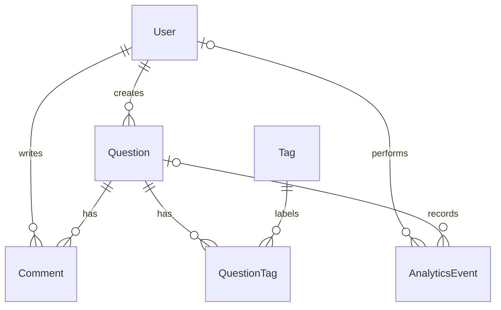

# Stack underflow — Developer Q&A Platform

[](https://github.com/Adul23/stack-underflow/actions/workflows/ci.yml)

A minimal Q&A platform where users can ask questions, add tags, browse existing
questions, search by keywords/tags, and leave answers/comments.

**Frontend:** Angular · **Backend:** Django REST Framework · **Database:** PostgreSQL

[Учебный отчёт на русском: MVP, диаграммы БД/CRUD, выполненные SQL и текущий поиск](docs/study/REPORT_RU.md)

```text
Angular → Django REST API → PostgreSQL
```

The existing user, question, tag and comment models are reused. The Questions
page has a keyword search box and a tag filter (`GET /api/questions/list?search=django&tag=python`).
Suggestions while typing wait 300 ms and show up to five matches. This is keyword
search without embeddings, backed by PostgreSQL trigram indexes. Analytics stores
search, question_view and question_created events, including an optional browser
session UUID.

## Semester scope

MVP "Must" features and their status at the final presentation:

| Feature | Status | Where |
|---|---|---|
| Registration and JWT login | Done | `/signup`, `/login`; `apps/users` |
| Ask a question with tags; edit/delete your own | Done | `/newquestion`, `/questions/edit/:slug`; `apps/questions` |
| Browse questions and open question details | Done | `/questions`, `/questions/:slug` |
| Comment on questions | Done | Question detail page; `apps/comments` |
| Browse tags and the questions under each tag | Done | `/tags`, `/tags/:slug`; `apps/tags` |
| Keyword + tag search (US-03) | Done | Search box + tag filter on `/questions`; `?search=&tag=` API, documented in Swagger |
| Database indexes with measured impact (US-08) | Done | Migrations + [EXPLAIN ANALYZE results](docs/explain_analyze.md): search 12.8 ms → 0.5 ms |
| Usage analytics | Partial | Events are recorded and summarised with [SQL queries](docs/analytics_queries.sql) and Django admin; there is no in-app dashboard |
| Public deployment | Partial | [Render setup](docs/deployment.md); the production frontend points at the Render API, which was not re-verified for this release |
| Automated tests | Partial | Backend pytest suite passes except one flaky legacy chat test; Angular specs need Chrome to run |

**Outside the MVP:** `backend/apps/chat` (WebSocket chat via Channels + Redis) is
a prototype that predates the semester scope. It is not in `INSTALLED_APPS`,
it is not part of the demo flow, and it is not required to run the MVP. The same
applies to the Celery/Redis services behind the `legacy` Compose profile, and to
the profile and user-management pages.

## Structure and database

```text
backend/                  Django apps and stack_underflow settings
frontend/                 Existing Angular components and services
docs/                     TSIS 3, schema, analytics and deployment
docker-compose.yml        Backend + PostgreSQL; optional legacy services
```



[Real table names, keys and fields](docs/database_schema.md) ·
[PostgreSQL DDL](docs/database_schema.sql) · [TSIS 3 deliverables](docs/TSIS3_MVP.md)

## Local setup with PostgreSQL

Use Python 3.12, Node.js 18/npm and Docker Compose. From the repository root:

```bash
cp backend/.env.example backend/.env
python3 -c 'import secrets; print(secrets.token_urlsafe(48))'
```

Put the generated value in STACK_UNDERFLOW_SECRET_KEY and choose a private
DB_PASSWORD in backend/.env. Existing private .env files should be preserved;
compare them with the example instead of copying over them.

Main variables: STACK_UNDERFLOW_ENV_ID=local, DB_NAME, DB_USER, DB_PASSWORD,
DB_HOST=127.0.0.1, DB_PORT=5432, DB_SSLMODE=disable, ALLOWED_HOSTS and
CORS_ALLOWED_ORIGINS. Keep the example's local host/origin values for development.
The .env file is ignored by Git.

Start PostgreSQL:

```bash
docker compose --env-file backend/.env up -d db
```

Start Django:

```bash
python3 -m venv .venv
source .venv/bin/activate
pip install -r backend/requirements/base.txt
cd backend
python manage.py check
python manage.py migrate
python manage.py createsuperuser
python manage.py runserver
```

In a second terminal, from the repository root:

```bash
cd frontend
npm ci
npm start
```

Open http://localhost:4200. API docs: http://127.0.0.1:8000/api/docs/.
Admin: http://127.0.0.1:8000/admin/. There is no email-confirmation or worker
requirement for registration. Leave DB_HOST empty only if choosing the optional
SQLite developer fallback; deployed environments always use PostgreSQL.

Alternatively, run the backend in Docker (do not run another server on port 8000):

```bash
docker compose --env-file backend/.env up --build -d
docker compose --env-file backend/.env exec backend python manage.py migrate
docker compose --env-file backend/.env exec backend python manage.py createsuperuser
```

Compose sets DB_HOST=db inside the backend container. Start Angular using the
same npm commands. Existing Redis and Celery services are behind the legacy profile.

The Docker backend runs `backend/start.py` on every start: migrations, demo data,
static files, then the API server. `backend/seed_demo.py` adds 12 example questions
and 8 tags without clearing the database; repeated runs skip existing examples.
Run `python seed_demo.py` manually from `backend/`, or set `SEED_DEMO_DATA=False`
to disable automatic inserts. For Render, use the Dockerfile's default command
or Python Start Command `python start.py` with Root Directory `backend`.
See [demo data and Render settings](docs/deployment.md#automatic-demo-data-on-docker-and-render).

## Verify the MVP

GitHub Actions runs on pushes and pull requests to `main`: the backend job uses
Python 3.12, runs Ruff and the MVP pytest suite against PostgreSQL 16, then builds
the backend Docker image. A separate job runs `npm ci` and `npm run build` for
Angular using Node.js 18. The legacy Redis/Channels tests are excluded, as below.

With the virtual environment activated, from backend/:

```bash
python manage.py makemigrations --check --dry-run
python -m pytest tests/MVPTests.py tests/QuestionsTests.py tests/SearchTests.py tests/SeedBulkTests.py tests/UsersTests.py tests/TagsTests.py tests/CommentsTests.py -q
```

The database user needs CREATEDB permission for Django's disposable test database
(the local Compose database user has it). These tests exclude the old Redis chat tests.

From frontend/:

```bash
npm run build
npm test -- --watch=false --browsers=ChromeHeadless --include=src/app/components/questions/questions.component.spec.ts --include=src/app/app.component.spec.ts
```

Chrome must be installed for browser tests. The production build fetches the
existing Google Font stylesheet and needs internet access.

## Demo script

About 5 minutes. Start PostgreSQL, Django and Angular as described above, then
open http://localhost:4200. Optionally run `python manage.py seed` first so the
lists are not empty.

1. **Register.** Click Sign up, create an account, then log in. The navbar
   switches to the logged-in state.
2. **Create a question with tags.** Click Ask Question and enter
   - title: *How do I paginate a DRF viewset?*
   - description: a sentence or two
   - tags: `python`, `django`

   Submit. The new question opens and shows its tags.
3. **Search.** Go to Questions.
   - Type `paginate`. Suggestions appear after 300 ms.
   - Press Search to see the full results.
   - Pick `#django` in the tag dropdown. The list narrows to keyword + tag matches.
   - Click a tag chip on any card to filter by that tag. Click Clear to reset.
   - Optional: show the same call in Swagger at http://127.0.0.1:8000/api/docs/
     (`GET /api/questions/list?search=paginate&tag=django`).
4. **Comment.** Open the question, add a comment, and reload the page. The
   comment is still there.
5. **View the analytics summary.** Run the SQL below. It shows searches per day,
   the most common search terms (including `paginate`), the most viewed
   questions, popular tags and active sessions. You can also open
   http://127.0.0.1:8000/admin/ → Questions → Analytics events to show the
   individual events the demo just created.
6. *(Optional)* **Performance.** Show the before/after table in
   [docs/explain_analyze.md](docs/explain_analyze.md).

Run the analytics SQL from the repository root (needs the Docker PostgreSQL database):

```bash
docker compose --env-file backend/.env exec -T db sh -c 'psql -U "$POSTGRES_USER" -d "$POSTGRES_DB" -v ON_ERROR_STOP=1' < docs/analytics_queries.sql
```

[Analytics fields and counting rules](docs/analytics.md) ·
[SQL queries](docs/analytics_queries.sql)

## Deployment and API URL

All frontend API calls use environment.apiUrl, with an optional public runtime
value in assets/config.js. For a separate production API host, after building:

```bash
cd frontend
STACK_UNDERFLOW_API_URL=https://api.your-domain.example/api npm run configure:api
```

See [deployment.md](docs/deployment.md) for exact PostgreSQL, DEBUG=False,
allowed-host, CORS, HTTPS, static-site and backend settings. No public deployment
has been performed from this workspace; hosting credentials are still needed.
