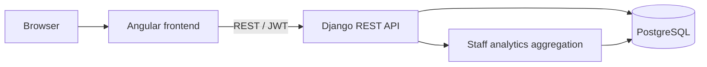

# Architecture

## Components

| Layer | Responsibility |
|---|---|
| Angular 14 | Pages, forms, routing, search suggestions and API calls |
| Django REST Framework | Authentication, validation, permissions and business logic |
| PostgreSQL | Users, questions, tags, comments and analytics events |
| Docker Compose | Local database and optional containerized backend |
| Swagger / OpenAPI | API exploration and schema |

## Repository map

`frontend/src/app/` contains Angular components and services. `backend/apps/` contains users, questions, tags, comments and analytics apps. `backend/stack_underflow/` contains Django configuration. `backend/tests/` contains pytest tests. The legacy chat prototype and optional Redis/Celery services are outside the MVP.

## Request flow

A visitor searches from Angular. The frontend calls the question list endpoint with keyword and optional tag. Django queries PostgreSQL using the search implementation and trigram indexes, records a search event for nonempty keywords, and returns results. Authenticated writes use JWT and backend permission checks. Staff analytics aggregates existing event rows; it does not require an external analytics service.

## Data and deployment

See [database schema](database_schema.md), [DDL](database_schema.sql), [analytics](analytics.md) and [recorded performance](explain_analyze.md). The frontend can be hosted separately from the API; the API URL is configurable. Production requires PostgreSQL and secure environment settings. The existing Render configuration and Google Fonts dependency are documented limitations, not mandatory hosting choices. See [deployment](deployment.md).
